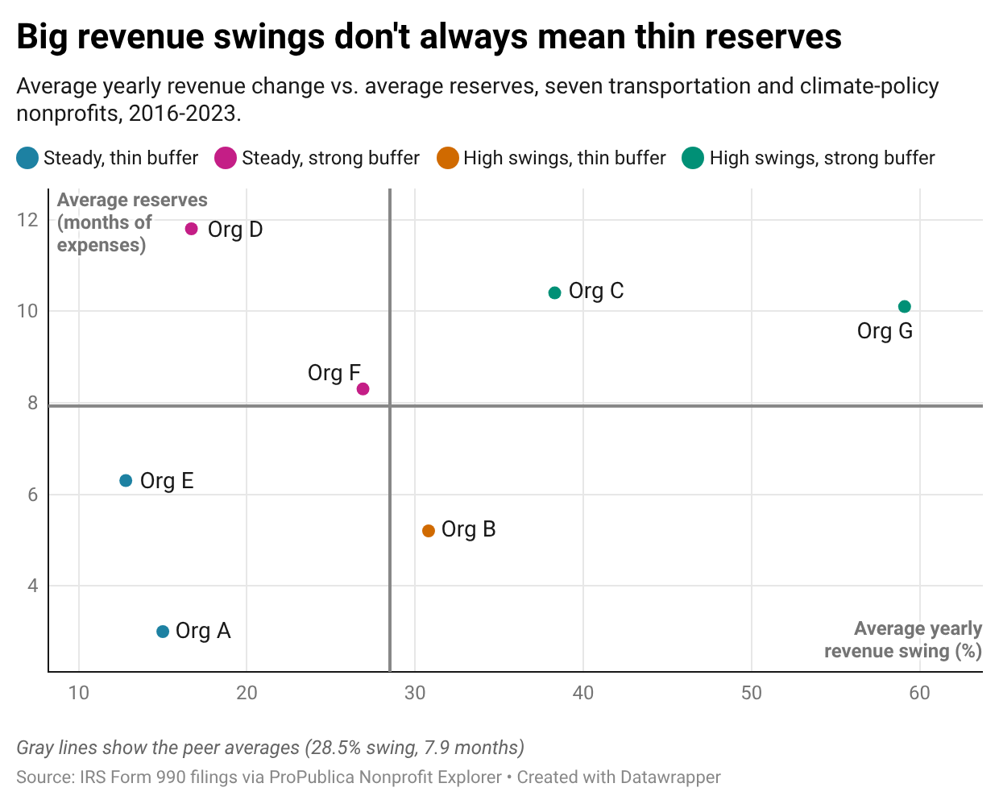

# Financial Resilience of Transportation and Climate-Policy Nonprofits

A SQL analysis of public IRS Form 990 filings for seven transportation and climate-policy nonprofits.

**Question:** Which organizations have the reserves to absorb their own revenue swings, and do these organizations share a common funding cycle?

**Tools:** SQLite (DB Browser for SQLite), Datawrapper. **SQL used:** joins, self-joins, chained CTEs, subqueries, window functions (`LAG`, `RANK`, `AVG() OVER`), conditional aggregation.

---

## Key findings



1. **Revenue is volatile, and unevenly so.** In the primary window (2016-2023), the typical year-over-year revenue change ranges from about 13% (Org E) to 59% (Org G). Part of Org G's figure is growth, not instability: its revenue grew more than eightfold over the window.
2. **Big swings do not automatically mean thin reserves.** The two most volatile organizations (Orgs C and G) also hold about 10 months of expenses in net assets.
3. **Org B is the only organization with above-average swings and below-average reserves** in the primary window (average swing 30.8%, reserves 5.2 months vs a peer average of 7.9). It stays in that group in the sensitivity window.
4. **Org F is borderline.** Its profile changes between windows because it sits within a fraction of both peer averages in 2017-2024 (0.5 points on swings, 0.1 months on reserves). I treat it as unclassified rather than as a real category change.
5. **Org A has the thinnest reserves (3.0 months) but one of the steadier revenue profiles (15% average swing),** and the lowest reliance on contributions (about 46% of revenue vs 72-93% for the others).
6. **There is little evidence of a shared funding cycle.** Across 162 organization-pair-years, revenues moved in the same direction 52.5% of the time, versus 50.0% expected if the organizations were unrelated. Co-movement was highest in 2021 (15 of 21 pairs) and 2016 (10 of 15 pairs), and at or below chance in the other six years. I started with the opposite hypothesis, from a two-organization comparison, and it did not hold up on the larger set.

### Profiles by window

Profiles compare each organization with the **peer average** on both measures, so they describe position within this group, not an outside standard.

| Org | 2016-2023: swing % | reserves (months) | profile | 2017-2024: swing % | reserves (months) | profile |
|---|---|---|---|---|---|---|
| A | 15.0 | 3.0 | Steady, thin buffer | 14.9 | 3.5 | Steady, thin buffer |
| B | 30.8 | 5.2 | High swings, thin buffer | 47.4 | 5.8 | High swings, thin buffer |
| C | 38.3 | 10.4 | High swings, strong buffer | 43.6 | 9.7 | High swings, strong buffer |
| D | 16.7 | 11.8 | Steady, strong buffer | 19.0 | 12.5 | Steady, strong buffer |
| E | 12.8 | 6.3 | Steady, thin buffer | 12.1 | 7.1 | Steady, thin buffer |
| F | 26.9 | 8.3 | Steady, strong buffer | 32.6 | 7.9 | High swings, thin buffer |
| G | 59.1 | 10.1 | High swings, strong buffer | 55.6 | 9.8 | High swings, strong buffer |
| *Peer average* | *28.5* | *7.9* | | *32.2* | *8.0* | |

Six of seven profiles are the same in both windows.

---

## Data

- **Source:** public IRS Form 990 filings, as extracted by [ProPublica Nonprofit Explorer](https://projects.propublica.org/nonprofits/).
- **Coverage:** 7 organizations, 91 organization-years, fiscal years 2010-2024.
- **Peer set:** nonprofits working on transportation, active mobility, and climate policy that file the full Form 990 and have several years of data. One candidate was excluded because it files as a private foundation (Form 990-PF) with a large endowment, so its revenue is mostly investment returns and is not comparable to donation-funded advocacy groups.
- **Anonymization:** organizations are labeled Org A to Org G, with no names or tax IDs, and the letters are in random order. The filings are public, so anyone determined could still look up the figures. The labels keep this repository from naming organizations, not from being identifiable.

### Cleaning and validation decisions

| Decision | Reason |
|---|---|
| Fiscal year = calendar year in which the fiscal period ends | Year-ends differ across organizations (December, March, September, June) |
| One organization's 3-month transition filing excluded | A short filing would distort every trend |
| Two organizations' early years excluded | Filed as a private foundation (990-PF) or the short Form 990-EZ, which lack comparable detail |
| One organization-year (2013) excluded | The source shows income figures identical to the next year; the following year ties out to the change in net assets, so the earlier row looks like a duplicate |
| Later of two returns used for one organization-year | The organization filed two returns for that fiscal year; the later one is used |

Every row passes two accounting checks (assets minus liabilities equals net assets; revenue minus expenses equals net income) and has no duplicate keys. Revenue, expenses, contributions, and program revenue were also spot-checked against the source pages for a sample of organization-years. That check found the two-return case above.

---

## Method

All queries are in [`sql/analysis.sql`](sql/analysis.sql), numbered in the order below.

| # | Query | Techniques |
|---|---|---|
| 1 | Coverage check | `JOIN`, `GROUP BY` |
| 2 | Year-over-year revenue growth | CTE, `LAG`, `PARTITION BY`, `CASE` |
| 3 | Each year vs the organization's own average | scalar subquery, CTE |
| 4 | Volatility ranking | chained CTEs, `RANK` |
| 5 | Resilience scorecard | conditional aggregation |
| 6 | Swings vs buffer profile, 2016-2023 | `AVG() OVER ()`, `CASE` |
| 7 | Same profile, 2017-2024 (sensitivity) | as above |
| 8 | Did funding cycles move together? | self-join |

**Measures**

- **Average swing:** the average size of year-over-year revenue change, ignoring direction. Growth is calculated only when the previous row really is the previous year, so no comparison crosses a missing year.
- **Reserve months:** net assets divided by one month of expenses. How long an organization could operate on reserves alone.
- **Windows:** 2016-2023 is the primary window because every organization has data. 2017-2024 is a sensitivity check. Multi-year averages are used instead of one year because a single year can mislead: an organization's worst year can make it look like the thinnest.

---

## Limitations

- **Seven organizations.** The results are descriptive and are not tested for statistical significance.
- **Profiles are relative.** The peer averages shift with the window, and "thin buffer" means thinner than these seven, not thin by an outside standard.
- **Swing mixes growth and instability.** A fast-growing organization scores as volatile even if its growth was steady.
- **Net assets are not cash.** They include property and donor-restricted funds, so reserve months is an upper bound on usable cushion.
- **Program-expense ratio and top-funder concentration are not covered.** They need the full functional-expense breakdown and donor names, which are not in the summary data or are redacted in public releases.
- **Extraction and amendments.** Figures come from ProPublica's extraction of the IRS data, which may not reflect amended returns.

---

## Reproduce it

1. Install [DB Browser for SQLite](https://sqlitebrowser.org/) (SQLite 3.25 or newer is required for window functions).
2. Create a new database. Import `data/organizations.csv` as a table named `organizations` and `data/filings.csv` as a table named `filings` (File > Import > Table from CSV file, with "column names in first line" checked).
3. Open the **Execute SQL** tab and run the queries in `sql/analysis.sql` one at a time.

## Repository structure

```
data/organizations.csv       one row per organization (anonymized)
data/filings.csv             one row per organization-year
data/chart_data.csv          numbers behind the chart
sql/analysis.sql             all queries, commented
figures/swings_vs_reserves.png
```

## Author

Dhanvi Doshi, MS Public Policy, NYU Wagner. [github.com/dhanvidoshilab](https://github.com/dhanvidoshilab)
